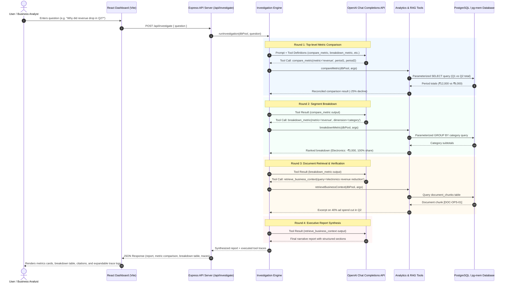

# System Architecture

## Overview
InsightAgent bridges the gap between conversational business queries and rigorous quantitative analysis. Instead of allowing the language model to write raw SQL (which often leads to schema hallucinations, arithmetic errors, and injection vulnerabilities), the application uses an **orchestrated function-calling architecture**.

---

## Detailed Request Flow

---

## Code Walkthrough: First Files to Open in an Interview

When explaining the project during an interview, open these core files in order:

1. **`server/tools/analyticsTools.js`**
   - *Why:* Demonstrates how analytics logic is strictly isolated in server-controlled functions. Show how dimensions are mapped from allowlists (`DIMENSION_COLUMNS`), parameters are sanitized, and exact numeric reconciliations are computed.
2. **`server/tools/toolDefinitions.js`**
   - *Why:* Shows the exact JSON Schema specifications provided to OpenAI function calling (`compare_metric`, `breakdown_metric`, `retrieve_business_context`, `verify_hypothesis`).
3. **`server/agent/investigationEngine.js`**
   - *Why:* Contains the core multi-turn tool execution loop. Explain how the agent receives tool calls, invokes the SQL layer, injects outputs back into conversation history, and handles round limits and fallback mock modes.
4. **`server/db/schema.sql` and `server/db/seedData.js`**
   - *Why:* Shows the relational database schema (orders, items, returns, document chunks) and deterministic synthetic benchmark data with known mathematical outcomes.
5. **`client/src/App.jsx`**
   - *Why:* Highlights the user interface: renders numbers from structured backend evidence rather than trusting generative LLM markdown alone, provides document excerpts with citation IDs, and visualizes raw execution steps.

---

## Database Schema & Indexing Strategy

- **`categories` & `products`**: Dimensional hierarchy.
- **`orders`**: Fact table storing transaction timestamps, sales channel (`Online`, `Retail`, `Direct`), and geographic regions (`North`, `South`, `East`, `West`).
  - Indexed on: `orders(order_date)`.
- **`order_items`**: Line items tracking unit selling price, unit cost, quantity, and pre-computed gross revenue and total cost.
  - Indexed on: `order_items(order_id)` and `order_items(category_id)`.
- **`order_returns`**: Return events linked to order items, refund amounts, return dates, and customer reasons.
  - Indexed on: `order_returns(order_id)` and `order_returns(return_date)`.
- **`document_chunks`**: Document repository storing policy sections, operational memos, and accounting rules for in-database text retrieval.
